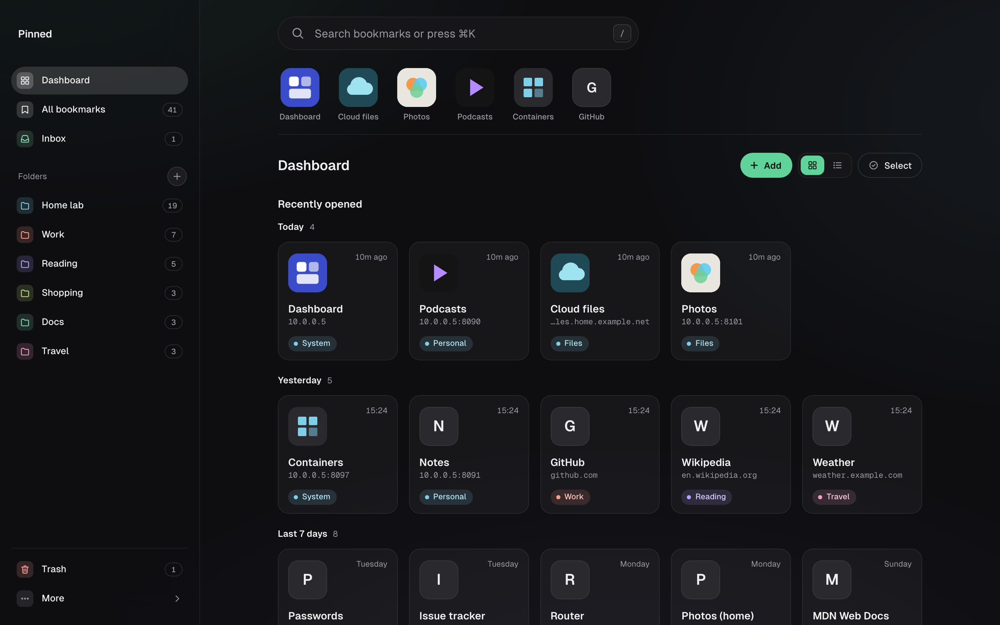

# Pinned

A self-hosted bookmark manager and start page for the services you run at home. Folders instead of tags, one user, one SQLite file. No tags, no page archiving, no accounts.



Folders that nest, search, a pinned row, an Inbox for quick saves, a Trash that keeps things for 30 days, import and export in the format every browser uses, a Save button for every browser, and search from the browser address bar (`/opensearch.xml`). One password, one binary, one data folder.

## Links to services: host plus port is the identity

Two links on the same host with different ports are two bookmarks. `http://10.0.0.5:8080` and `http://10.0.0.5:9000` are kept apart, and the port is always shown. An IP address stays an IP address.

To decide whether a link is already saved, the app compares the address with the scheme and host lowercased, the default port removed (`:80` for http, `:443` for https), the part after `#` dropped, and an empty path read as `/`. Everything else has to match exactly. Any host works, including single word names like `homelab`.

## Install in five minutes

You need Docker with the compose plugin, on amd64 or arm64. A NAS, a Raspberry Pi or an old laptop at home works; so does the smallest server at any hosting provider, which is the way without hardware of your own.

### On a fresh server, one command

`extras/vps/setup.sh` installs Docker if it is missing, writes the compose file into `~/pinned`, asks for the password once and starts the container:

```sh
curl -fsSL https://raw.githubusercontent.com/pinned-cc/pinned/v0.1.11/extras/vps/setup.sh | sh
```

It asks for the password on the terminal. Where there is no terminal to ask on, such as cloud-init, pass it in: `curl -fsSL ... | APP_PASSWORD='...' sh`. Pinned then answers on port 9095 of that server only (`127.0.0.1`), and the script ends with the next step: put HTTPS in front on the same server (Caddy, Traefik or a Cloudflare tunnel) and point it at `127.0.0.1:9095`, see Behind a reverse proxy. To reach Pinned on plain http from other machines instead, set `PINNED_BIND=0.0.0.0` (or one address of the server); the script then warns that your password crosses the network unencrypted. A firewall such as ufw does not block a port Docker publishes. The password goes into `~/pinned/app_password`, readable only by the user the container runs as, and the script says Pinned runs only once it answers. `PINNED_DIR`, `PINNED_PORT`, `PINNED_BIND`, `PINNED_IMAGE` and `APP_PASSWORD` in the environment override the defaults. The script installs the image of its own release; to update, run the command of the newer release again. If Docker is missing, it installs it with Docker's installer (github.com/docker/docker-install), pinned to one commit and checked by its checksum; that installs the current Docker Engine from Docker's package repository. It asks no other site for anything; only when Pinned is published on every address and the server cannot tell its own address does it ask ifconfig.me, to print the address. Not yet run on a rented server at the time of writing; the steps below are the same thing by hand.

### By hand

The image is published at `ghcr.io/pinned-cc/pinned` for amd64 and arm64, from version 0.1.0 on. To build it yourself instead, see Building from source.

1. Make a folder for it and a data folder that the container user (1000) can write:

   ```sh
   mkdir pinned && cd pinned
   mkdir data && sudo chown 1000:1000 data
   ```

2. Save this as `docker-compose.yml` (it is the same file as in this repository):

   ```yaml
   services:
     pinned:
       image: ghcr.io/pinned-cc/pinned:latest
       container_name: pinned
       environment:
         APP_PASSWORD: ${APP_PASSWORD:?set APP_PASSWORD}
         TZ: UTC # your time zone, used for the 03:00 export
       volumes:
         - ./data:/data
       ports:
         - "9095:8080"
       restart: unless-stopped
       # The app writes only to /data; everything else stays read only.
       read_only: true
       tmpfs:
         - /tmp
       cap_drop:
         - ALL
       security_opt:
         - no-new-privileges:true
       # The image has a HEALTHCHECK (pinned -healthcheck), nothing to add here.
   ```

3. Start it with a password of at least 8 characters that is not a common password (docs/security.md says which are refused):

   ```sh
   APP_PASSWORD='choose a long one' docker compose up -d
   ```

   Or put `APP_PASSWORD=...` in a `.env` file next to the compose file, so you do not have to type it again.

4. Open `http://<your server>:9095` and log in with that password.

To see what it is doing: `docker compose logs pinned`. What it logs, and how to keep the log or send it elsewhere, is in [docs/security.md](docs/security.md#logs).

### Portainer on Umbrel

1. In Portainer, add a stack and paste the compose file. Replace `./data` with a full path to a folder on the device that user 1000 can write (`sudo chown 1000:1000 <folder>`).
2. Add `APP_PASSWORD` under environment variables.
3. Deploy, then open `http://<your umbrel>:9095`.

## Settings

All settings are environment variables.

| Variable | Default | What it does |
|---|---|---|
| `APP_PASSWORD` | none, required | The login password, at least 8 characters. The app does not start without it and never logs it. |
| `APP_PASSWORD_FILE` | empty | A file that holds the password instead, such as a Docker secret. One trailing newline is dropped. Set this or `APP_PASSWORD`, not both. |
| `TZ` | `UTC` | Time zone for the nightly export at 03:00. |
| `BASE_URL` | taken from each request | The address people use, for example `https://bookmarks.example.com`. Used in the Save button code and the browser search entry. Set it when the app runs behind a proxy. When it starts with `https://`, a request for that host name with no `X-Forwarded-Proto` counts as HTTPS (see Behind a reverse proxy). |
| `TRUSTED_PROXIES` | empty | Addresses or networks of your reverse proxies, comma separated, for example `172.16.0.0/12` or `10.0.0.1, fd00::/8`. Only from these are `X-Forwarded-For` and `X-Forwarded-Proto` read. Empty means `X-Forwarded-For` is ignored and `X-Forwarded-Proto` is believed from any loopback, private or `100.64.0.0/10` address, so set it when a proxy does HTTPS (see Behind a reverse proxy). |
| `HSTS` | off | `true` sends `Strict-Transport-Security: max-age=31536000` on HTTPS answers, a number of seconds sets another max-age. Off by default because it applies to the whole host name on every port (see Behind a reverse proxy). |
| `SESSION_DAYS` | `90` | How long a login lasts when it is not used. Using it renews it for this many days again, up to `SESSION_MAX_DAYS`. |
| `SESSION_MAX_DAYS` | `365` | The longest a login lasts from the moment you logged in, however much it is used. Then you log in again. |
| `TOTP_SECRET` | empty, off | Turns on a second factor: the login also asks for a code from an authenticator app. 20 random bytes in base32, at least 16 bytes (26 characters). See Second factor. |
| `TOTP_SECRET_FILE` | empty | A file that holds `TOTP_SECRET` instead. One trailing newline is dropped. Set this or `TOTP_SECRET`, not both. |
| `ICONS` | `on` | `off` stops every icon fetch. Icons already stored stay. |
| `ICON_HOSTS` | empty | Host names icon fetches may connect to, comma separated, each with its subdomains, for example `github.com, example.org`. Bookmarks on other hosts keep their letter. Empty means any public host. |
| `DATA_DIR` | `/data` | The data folder. |
| `PORT` | `8080` | The port inside the container. |

The image runs `pinned -healthcheck` as its Docker health check every 30 seconds, so the compose file needs none. Without a login, `/health` answers only `{"ok":true}`.

The limits the server enforces, its keys, what it stores and what it logs are listed in [docs/security.md](docs/security.md).

## Second factor

The login can ask for a code from an authenticator app as well as the password. It is off until you set `TOTP_SECRET`.

1. Make a secret of 20 random bytes in base32:

   ```sh
   head -c 20 /dev/urandom | base32
   ```

   On a Mac, which has no `base32`:

   ```sh
   python3 -c 'import base64, os; print(base64.b32encode(os.urandom(20)).decode())'
   ```

2. Set it as `TOTP_SECRET` in the `.env` file or the compose file, or put it in a file and set `TOTP_SECRET_FILE` to that file. Run `docker compose up -d`.
3. In your authenticator app, add an account by hand with the secret as the setup key: time based, 6 digits, 30 seconds.
4. The login now asks for the code. Each code works once.

Browsers that are already logged in stay logged in; end them under Signed in. API tokens work without a code. If you lose the authenticator app, remove `TOTP_SECRET` and run `docker compose up -d`: the login asks for the password only again.

## Ways to save

Open How to save in the app's menu (the page is at `/bookmarklet`). It has every option below with the steps for each device.

**Bookmarklet.** A Save button for the bookmarks bar on a Mac (Brave, Chrome, Safari), or a Safari bookmark on the iPhone.
It opens a small save page with the title and address filled in and your recent folders.

**Home screen app.** Add the app to the home screen on the iPhone or Android.
It opens without browser bars, like an app.

**Android share target.** Once the app is on the Android home screen, it shows up in the share sheet as Pinned.
Share a page to it and the save page opens.

**Browser extension.** Download it from the How to save page and load it unpacked in Brave, Chrome or Edge, or as a temporary add-on in Firefox. Firefox removes a temporary add-on when it quits, so after a restart load it again and give it a new token. In its options the address can be typed without `http://`: it tries https, then http.
It has a save popup with your recent folders and a right click menu. See `extras/extension/README.md`.

**The API with a token.** Scripts, Raycast, Home Assistant and n8n can save with an API token.
`extras/examples` has a ready file for each, with the setup in its `README.md`.

```sh
# the folders, to pick one
curl -H 'Authorization: Bearer tk_...' https://bookmarks.example.com/api/folders

# is this link saved already?
curl -H 'Authorization: Bearer tk_...' 'https://bookmarks.example.com/api/check?url=https%3A%2F%2Fexample.com%2F'

# save it; folder_id null puts it in the Inbox
curl -H 'Authorization: Bearer tk_...' -H 'Content-Type: application/json' \
  -d '{"title":"Example","url":"https://example.com/","folder_id":null}' \
  https://bookmarks.example.com/api/bookmarks
```

A saved link answers 201. A link that is already saved answers 409 with the bookmark that has it. A link saved only in a locked folder counts as not saved: it is saved again, outside the locked folder.

## API tokens

Create a token in the app under API tokens, in the menu next to Import and Export. The token is shown once, when you create it. Copy it then. The list shows when each token was created and last used. Revoke stops a token at once.

A token can do four things, and nothing else:

- read your folders and bookmarks (`GET /api/state`, `GET /api/folders`),
- check whether a link is saved (`GET /api/check`),
- save a bookmark (`POST /api/bookmarks`),
- change a saved bookmark's title or folder (`PATCH /api/bookmarks/{id}` with only `title` and `folder_id`).

Everything else answers 403 with a token: export, import, Trash and delete, creating, renaming, moving or deleting folders, shares, locks, creating or revoking tokens, and the list of signed in browsers.

Creating a token asks for the app password again, so a browser left open cannot hand out tokens.

A token never sees inside a locked folder, even one you unlocked in your browser. The extension keeps its token in the browser's storage. A token belongs to the first copy of the extension that uses it. After that, a request with the token that names any other origin, another extension or a web page, gets 403; a request that names no origin, as scripts, shortcuts and the examples send, still works. After you reinstall the extension in Firefox or Safari, create a new token for it. Scripts are not affected.

## Signed in browsers

Signed in, in the app's menu, lists the browsers that are logged in, with when each logged in and when it was last used. Sign out ends one of them; Sign out all others ends every one but the browser you are using. Both ask for the app password first, so someone who got hold of one session cannot keep signing you out.

## Wrong passwords and tokens

Wrong app passwords and wrong tokens are counted apart, per address (IPv6 per /64). Wrong share passwords are counted for each share link on its own, and wrong folder passwords for each folder, so tries at one never hold another. A wrong second factor code counts as a wrong app password, and wrong codes after the right password are also counted for everyone together: after 5 in a row no login is checked for 1 minute, then 2, doubling up to a day, until a right code. Every wrong try waits one second before it answers, and password tries from one address are checked one at a time. After 5 wrong tries the address has to wait 30 seconds (status 429); during the wait no password is checked, not even the right one. After 100 wrong tries within 10 minutes from all addresses together, every browser that has not logged in before waits until the count drops. For share and folder passwords that limit of 100 counts per share link and per folder.

A browser that has logged in with the password keeps a signed `pinned_device` cookie (`__Host-pinned_device` over HTTPS) for 400 days, until the app password changes. It is counted on its own, by that cookie instead of its address, for the app password and for share and folder passwords, and the limit of 100 does not apply to it, so someone guessing from many addresses cannot lock you out of your own browsers. The cookie is not a login; it only changes how wrong tries are counted. A valid token always gets through, and wrong tokens are counted apart from the login, so a broken script with an old token does not lock you out.

## Behind a reverse proxy

The app speaks plain HTTP on one port. For access from outside your home, put it behind a proxy that does HTTPS, such as Caddy, Nginx Proxy Manager or Traefik. It has to sit at the root of a host name, not under a path like `/bookmarks`.

Give Pinned a host name of its own when other services run on the same machine. Browsers scope cookies by host name, not by port: with Pinned at `nas.local:9095` and other services at `nas.local:8080` and the like, the browser sends Pinned's login cookie to all of them, and any of them could read it from its own requests or logs. Over HTTPS the `__Host-` cookies are still sent to the other ports of that name. A subdomain on your proxy, such as `bookmarks.example.com`, or `tailscale serve` on a Tailscale machine name that only Pinned uses, keeps its cookies to Pinned.

- Set `BASE_URL` to the public address, for example `https://bookmarks.example.com`. The Save button code and the browser search entry use it.
- The app treats a request as HTTPS when the proxy sends `X-Forwarded-Proto: https`. Caddy, Traefik, Nginx Proxy Manager and Cloudflare Tunnel send that header. The header is believed only from the addresses in `TRUSTED_PROXIES`, or, when that is empty, from loopback, private and `100.64.0.0/10` addresses, where a proxy in front of a home server sits. From anyone else it is ignored. When a proxy does HTTPS, set `TRUSTED_PROXIES` too. Without it the header is believed from any private address, and behind Docker's published ports every client arrives from one, so any client can send the header itself. That changes only the answers that client gets (cookie names and the Secure flag, HSTS, the scheme of links), not anyone else's.
- A proxy that sends no `X-Forwarded-Proto`, such as `tailscale serve`, is covered by `BASE_URL`: when it starts with `https://` and the request is for that same host name, the request counts as HTTPS.
- Over HTTPS the login cookie is named `__Host-pinned_session` and marked Secure. Over plain HTTP on your network, the cookie stays `pinned_session`. Only open the `BASE_URL` host name over HTTPS: over plain HTTP the browser refuses its cookie and the login does not stick.
- Set `HSTS=true` only when Pinned has its own host name on the public internet and your proxy does not already send `Strict-Transport-Security`. It is off by default because the browser then uses HTTPS for the whole host name on every port, which breaks other plain http services on the same NAS or Tailscale name.
- Set `TRUSTED_PROXIES` to the proxy's address or network. The app then reads the visitor's address from `X-Forwarded-For`. Without it, every visitor looks like the proxy, and wrong passwords from anyone slow down everyone, you included.

Caddy, as a whole `Caddyfile`:

```text
bookmarks.example.com {
    reverse_proxy localhost:9095
}
```

On Nginx Proxy Manager, add a proxy host for your server and port 9095 with an SSL certificate. On Traefik, route a host rule to the container's port 8080.

On Umbrel with the App Store package (`umbrel/` holds the draft), Umbrel's login sits in front of the app. These paths must get past it, because the extension, scripts and share links do not carry an Umbrel login: `/api/*`, `/s/*`, `/extras/*` and `/health`, and for share link pages `/static/*` and `/favicon.svg`. The app's own password, tokens and share links still protect them.

## Troubleshooting

**The container restarts and the log says it cannot write to /data as user 1000.** Docker made the data folder as root, because it did not exist when the container first started. The container runs as user 1000. Give the folder to that user and start again: `sudo chown -R 1000:1000 ./data`, then `docker compose up -d`.

**The Save bookmark opens a black page in Safari on the iPhone, marked Not Secure.** This happens with iCloud Private Relay on, when the app is reached through a Tailscale address (`*.ts.net`). Save runs inside the page you are on, and with Private Relay that page goes through Apple, which cannot reach your tailnet. Safari then falls back to http. Opening the app directly still works, which makes it look like a bookmark problem. It is not.

The fix, with Private Relay left on: let Tailscale resolve the name on that iPhone. In the Tailscale admin, copy the iPhone's address under Machines, then add this to the policy file under Access controls and save:

```json
"nodeAttrs": [
  { "target": ["100.x.y.z"], "attr": ["disable-split-dns-when-no-custom-resolvers"] }
],
```

Turn Tailscale off and on again on the iPhone. How to save in the app has the same steps. Tailscale tracks the cause in [tailscale/tailscale#21677](https://github.com/tailscale/tailscale/issues/21677).

**Behind `tailscale serve`, the Save code starts with http.** `tailscale serve` ends HTTPS but does not send `X-Forwarded-Proto`. How to save uses the address in your browser when it is on the same host. Set `BASE_URL` to the `https://` address to fix the search entry too; it also gives the login cookie its Secure flag behind `tailscale serve`.

**Pinned as the start page on the iPhone.** Safari, Chrome and Brave on iOS cannot open a page of your own as their start page. Firefox can (Settings, Homepage, Custom URL) and so can Vivaldi (Settings, General, Display Home Button, then Specific Site). In Safari the closest is Share, Add to Favorites, which shows Pinned as the first tile on every new tab. How to save in the app has the same steps and your address to copy.

## Your data and backups

Everything is in the data folder:

- `bookmarks.db`, the SQLite database, with `bookmarks.db-wal` and `bookmarks.db-shm` next to it while the app runs.
- `secret.key`, the key for sessions, tokens and folder and share passwords. Without it every session ends, every token stops working and folder and share passwords no longer match. How to replace it is in [docs/security.md](docs/security.md#rotating-secretkey).
- `icons/`, the site icons.
- `export/bookmarks.html`, written every night at 03:00 (in `TZ`) and on start when it is older than a day. It is a normal browser bookmarks file with your folders and links, locked folders included. It leaves out Trash, pins, locks and shares.
- `bookmarks-schema6-2026-10-30-154210.db` and the like, copies of the database taken before an upgrade (see Upgrading).

The tables and the export format are described in `docs/data-format.md`. You can read the database with any SQLite tool.

Only the user the app runs as can read the data folder: folders are 0700 and files 0600. At start the app makes files that an older version left readable by everyone private too. A backup job that reads the data folder or the nightly export has to run as that same user (1000 in the image), or as root.

**Backing up.** The database runs in WAL mode, so copying `bookmarks.db` alone while the app runs can give you a broken copy. Either take a copy with SQLite itself:

```sh
sqlite3 data/bookmarks.db ".backup backup.db"
```

or stop the container, copy the whole data folder, and start it again:

```sh
docker compose stop && cp -a data data-backup && docker compose start
```

Keep `secret.key` and `icons/` with the database.

**Restoring.** Stop the container, put the files back in the data folder (a `.backup` copy goes back as `bookmarks.db`, with no `-wal` or `-shm` files next to it), make sure user 1000 owns them, and start it.

**Upgrading.** `docker compose pull` and then `docker compose up -d`. The database is upgraded on start. When a new version changes the database, Pinned first saves a copy of it as it was in the data folder, named with the old schema number and the date and time, for example `bookmarks-schema6-2026-10-30-154210.db`, and the log names the file. The last three copies are kept; older ones are removed. If an upgrade fails and Pinned starts again, a new copy with the same content replaces the one before, so a crash loop does not push out older copies. If the copy cannot be written (a full disk, a folder it cannot write to), Pinned does not upgrade and stops with a message saying why; the database stays as it was. The copies hold your bookmarks, so treat them like `bookmarks.db`.

**Going back to an older version.** An older version does not start on a database a newer one has upgraded. Stop the container, move `bookmarks.db` aside, copy the backup from before the upgrade to `bookmarks.db` (no `-wal` or `-shm` files next to it; remove them if they are there), make sure user 1000 owns it, set the image back to the older version and start it. The copy is your data as it was before the upgrade. Links saved since are not in it, so export them first from the newer version if you need them. Folders you locked, lock and share passwords you changed and share links you revoked since are back as they were: a revoked link opens again. After going back, lock those folders and revoke those links again. Keep `secret.key` and `icons/` as they are: 0.1.11 keeps the PNG and JPEG icons of older versions next to the ones it re-encodes, so they show again. Icons 0.1.11 removed because they did not decode or failed its SVG check show the letter until each is fetched again with `POST /api/bookmarks/{id}/refetch-icon`.

**Upgrading to 0.1.11 with a common app password.** 0.1.11 refuses common app passwords (see docs/security.md). If yours ran under an older version, Pinned still starts, writes a warning to the log and shows one in the app: change `APP_PASSWORD` to a stronger one and restart. A new install or a new password that is common is refused at start.

**Changing the password.** Change `APP_PASSWORD` and run `docker compose up -d`. Every browser is logged out, every API token is revoked and every device cookie ends. Create new tokens for the extension and your scripts.

**Import.** Export a bookmarks file from your browser and use Import in the app. Folders are kept. Links that are already saved are skipped, so importing the same file twice adds nothing; a link saved only in a locked folder comes in again. Files can be up to 20 MB. Links whose address is longer than 8192 bytes are skipped. Folders nest at most 32 deep; anything deeper in the file lands in the folder at depth 32. A file whose folders nest more than 256 deep is refused with a message. A large file is saved in short steps, so saving and logging in from other browsers go on meanwhile. If a folder it writes into is deleted or locked meanwhile, the import stops with a message saying how many links came in; import the file again to add the rest. Tested with files in Brave's export format.

## Locked folders and share links

**Locked folders.** A folder can have its own password, so its links stay out of sight when you share your screen or show the app to someone. While a folder is locked, its subfolders and bookmarks do not show anywhere in the app: not in the folder lists, search, Recent, the pinned row, Inbox or Trash. Only the folder's name is shown. Unlocking opens it in that browser for 10 minutes, or until you lock it again. A folder password needs at least 8 characters and cannot be a common password; locks set earlier with fewer characters keep working. Changing it asks for the current one.

What a lock does not do:

- It does not encrypt anything. The database and the nightly `export/bookmarks.html` hold every link in plain form, locked folders included. Export in the app leaves out the folders that are locked in that browser.
- It does not protect against someone who has the app password.
- Saving, checking or importing an address that sits only in a locked folder does not say so: it is saved again as a new bookmark, outside the locked folder. After you unlock the folder, that address shows twice; delete the one you do not want.
- A folder password cannot be recovered. If you forget it, remove the lock with the app password.

A locked folder cannot be shared. Locking a folder removes any share link on it or its subfolders, and so does moving a shared folder into a locked one. An import never writes into a locked folder: a folder in the file with the same name comes in beside it as `<name> (imported)`.

**Share links.** You can share one folder, with its subfolders, as a read only link. People with the link see the titles and links in it and can open them, nothing more.

- The link looks like `https://bookmarks.example.com/s/#<token>`. The part after `#` never reaches the server or a proxy's log. Links of the older form `/s/<token>` keep working.
- The token holds 24 random bytes, so it cannot be guessed. It works for anyone who has it, so send it like a password. It is kept as it is, so the share sheet shows the link again whenever you open it.
- You can add a password of at least 8 characters that is not a common password. After the right password, the browser stays unlocked for 7 days. Wrong passwords are counted for each link on its own (see Wrong passwords and tokens).
- You can set it to expire after 1 to 3650 days, or never.
- Revoke stops it at once. Changing the share password locks out browsers that were already unlocked.
- The app counts how often the link was opened (once per browser per hour) and when.

Shares are not part of the export.

## What the server sends out

One thing: the icon of each site you save. When you save a link or change its address, the server loads that page once to find the icon, then downloads the icon. The request comes from your server, with the user agent `Mozilla/5.0 (compatible; Pinned bookmarks; favicon fetch)`. It goes only to public addresses, with one exception: a bookmark whose own host is on your network (a private, loopback or link local address) may load its icon from that same host. It connects only on ports 80 and 443 and on the port of the bookmark's own address, and never steps from `https` down to plain `http` on a redirect. Certificates are checked, so a service with a self-signed certificate gets no icon.

To stop it, set `ICONS=off`. To keep it to some sites, set `ICON_HOSTS`. Or block connections out of the container in your firewall; bookmarks then keep their letter.

No telemetry, no update checks, no fonts or scripts from other servers. The pages, the extension and the fonts are all served from your own server.

## Footprint

- The binary is about 12 MB. The image holds the binary, CA certificates and time zone data, nothing else.
- Memory is about 40 MB when idle, as measured on 2026-10-12.
- Images are built for amd64 and arm64.

## Building from source

You need Go, the version named in `go.mod`. No C compiler.

```sh
go build ./cmd/pinned
go test ./...
```

The result is one static binary with the web files inside it. Run it with `APP_PASSWORD` set; `-version` prints the version and `-healthcheck` checks a running server.

To build the image yourself:

```sh
docker build -t pinned .
```

Then use `image: pinned` in the compose file. For working on the code, see `CONTRIBUTING.md`.

## Licence

AGPL-3.0-only. See [LICENSE](LICENSE).

Copyright 2026 the Pinned authors.
