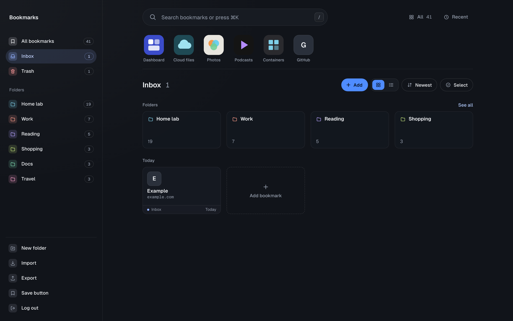

# Pinned

A self-hosted bookmark manager and start page for the services you run at home. Folders instead of tags, one user, one SQLite file. No tags, no page archiving, no accounts.



Folders that nest, search, a pinned row, an Inbox for quick saves, a Trash that keeps things for 30 days, import and export in the format every browser uses, a Save button for every browser, and search from the browser address bar (`/opensearch.xml`). One password, one binary, one data folder.

## Links to services: host plus port is the identity

Two links on the same host with different ports are two bookmarks. `http://10.0.0.5:8080` and `http://10.0.0.5:9000` are kept apart, and the port is always shown. An IP address stays an IP address.

To decide whether a link is already saved, the app compares the address with the scheme and host lowercased, the default port removed (`:80` for http, `:443` for https), the part after `#` dropped, and an empty path read as `/`. Everything else has to match exactly. Any host works, including single word names like `homelab`.

## Install in five minutes

You need Docker with the compose plugin, on amd64 or arm64. A NAS, a Raspberry Pi or an old laptop at home works; so does the smallest server at any hosting provider, which is the way without hardware of your own.

### On a fresh server, one command

`extras/vps/setup.sh` installs Docker if it is missing, writes the compose file into `~/pinned`, asks for the password once and starts the container:

```sh
curl -fsSL https://raw.githubusercontent.com/pinnedcc/pinned/main/extras/vps/setup.sh | sh
```

Pinned then answers on port 9095. Put HTTPS in front before you use it from outside your network, see Behind a reverse proxy. `PINNED_DIR`, `PINNED_PORT` and `APP_PASSWORD` in the environment override the questions. Not yet run on a rented server at the time of writing; the steps below are the same thing by hand.

### By hand

The image is published at `ghcr.io/pinnedcc/pinned` with the first release. Until then there is nothing to pull: build it yourself, see Building from source.

1. Make a folder for it and a data folder that the container user (1000) can write:

   ```sh
   mkdir pinned && cd pinned
   mkdir data && sudo chown 1000:1000 data
   ```

2. Save this as `docker-compose.yml` (it is the same file as in this repository):

   ```yaml
   services:
     pinned:
       image: ghcr.io/pinnedcc/pinned:latest
       container_name: pinned
       environment:
         APP_PASSWORD: ${APP_PASSWORD:?set APP_PASSWORD}
         TZ: UTC # your time zone, used for the 03:00 export
       volumes:
         - ./data:/data
       ports:
         - "9095:8080"
       restart: unless-stopped
       # The app writes only to /data; everything else stays read only.
       read_only: true
       tmpfs:
         - /tmp
       cap_drop:
         - ALL
       security_opt:
         - no-new-privileges:true
       # The image has a HEALTHCHECK (pinned -healthcheck), nothing to add here.
   ```

3. Start it with a password of at least 8 characters:

   ```sh
   APP_PASSWORD='choose a long one' docker compose up -d
   ```

   Or put `APP_PASSWORD=...` in a `.env` file next to the compose file, so you do not have to type it again.

4. Open `http://<your server>:9095` and log in with that password.

To see what it is doing: `docker compose logs pinned`.

### Portainer on Umbrel

1. In Portainer, add a stack and paste the compose file. Replace `./data` with a full path to a folder on the device that user 1000 can write (`sudo chown 1000:1000 <folder>`).
2. Add `APP_PASSWORD` under environment variables.
3. Deploy, then open `http://<your umbrel>:9095`.

## Settings

All settings are environment variables.

| Variable | Default | What it does |
|---|---|---|
| `APP_PASSWORD` | none, required | The login password, at least 8 characters. The app does not start without it and never logs it. |
| `TZ` | `UTC` | Time zone for the nightly export at 03:00. |
| `BASE_URL` | taken from each request | The address people use, for example `https://bookmarks.example.com`. Used in the Save button code and the browser search entry. Set it when the app runs behind a proxy. |
| `TRUSTED_PROXIES` | empty | Addresses or networks of your reverse proxies, comma separated, for example `172.16.0.0/12` or `10.0.0.1, fd00::/8`. Only for requests from these is `X-Forwarded-For` read. Empty means the header is ignored. |
| `SESSION_DAYS` | `90` | How long a login lasts. A login in use is renewed for the full time again. |
| `DATA_DIR` | `/data` | The data folder. |
| `PORT` | `8080` | The port inside the container. |

The image runs `pinned -healthcheck` as its Docker health check every 30 seconds, so the compose file needs none. Without a login, `/health` answers only `{"ok":true}`.

## Ways to save

Open Save button in the app's menu (the page is at `/bookmarklet`). It has every option below with the steps for each device.

**Bookmarklet.** A Save button for the bookmarks bar on a Mac (Brave, Chrome, Safari), or a Safari bookmark on the iPhone.
It opens a small save page with the title and address filled in and your recent folders.

**Home screen app.** Add the app to the home screen on the iPhone or Android.
It opens without browser bars, like an app.

**Android share target.** Once the app is on the Android home screen, it shows up in the share sheet as Pinned.
Share a page to it and the save page opens.

**iOS Shortcut.** Tap Add the Shortcut on the Save button page on the iPhone. It asks for your address and an API token.
The share sheet then has Save to Pinned. It saves to the Inbox first, then lets you pick a folder. See `extras/shortcut/README.md`.

**Browser extension.** Download it from the Save button page and load it unpacked in Brave, Chrome or Edge, or as a temporary add-on in Firefox.
It has a save popup with your recent folders and a right click menu. See `extras/extension/README.md`.

**The API with a token.** Scripts, Raycast, Home Assistant and n8n can save with an API token.
`extras/examples` has a ready file for each, with the setup in its `README.md`.

```sh
# the folders, to pick one
curl -H 'Authorization: Bearer tk_...' https://bookmarks.example.com/api/folders

# is this link saved already?
curl -H 'Authorization: Bearer tk_...' 'https://bookmarks.example.com/api/check?url=https%3A%2F%2Fexample.com%2F'

# save it; folder_id null puts it in the Inbox
curl -H 'Authorization: Bearer tk_...' -H 'Content-Type: application/json' \
  -d '{"title":"Example","url":"https://example.com/","folder_id":null}' \
  https://bookmarks.example.com/api/bookmarks
```

A saved link answers 201. A link that is already saved answers 409 with the bookmark that has it.

## API tokens

Create a token in the app under API tokens, in the menu next to Import and Export. The token is shown once, when you create it. Copy it then. The list shows when each token was created and last used. Revoke stops a token at once.

A token can do four things, and nothing else:

- read your folders and bookmarks (`GET /api/state`, `GET /api/folders`),
- check whether a link is saved (`GET /api/check`),
- save a bookmark (`POST /api/bookmarks`),
- change a saved bookmark's title or folder (`PATCH /api/bookmarks/{id}` with only `title` and `folder_id`).

Everything else answers 403 with a token: export, import, Trash and delete, creating, renaming, moving or deleting folders, shares, locks, and creating or revoking tokens.

A token never sees inside a locked folder, even one you unlocked in your browser. The extension keeps its token in the browser's storage, and the Shortcut keeps it inside the shortcut, so anyone who can open the shortcut in the Shortcuts app can read it. Do not pass on your installed shortcut; point people to the download instead.

## Wrong passwords and tokens

Wrong app passwords, wrong tokens and wrong share passwords are counted apart, per address (IPv6 per /64). Every wrong try waits one second before it answers. After 5 wrong tries the address has to wait 30 seconds (status 429). A right password or a valid token always gets through, so a broken script with an old token does not lock you out of the login.

## Behind a reverse proxy

The app speaks plain HTTP on one port. For access from outside your home, put it behind a proxy that does HTTPS, such as Caddy, Nginx Proxy Manager or Traefik. It has to sit at the root of a host name, not under a path like `/bookmarks`.

- Set `BASE_URL` to the public address, for example `https://bookmarks.example.com`. The Save button code and the browser search entry use it.
- The login cookie is marked Secure when the request came over HTTPS, or when the proxy sends `X-Forwarded-Proto: https`. Caddy, Traefik and Nginx Proxy Manager send that header.
- Set `TRUSTED_PROXIES` to the proxy's address or network. The app then reads the visitor's address from `X-Forwarded-For`. Without it, every visitor looks like the proxy, and wrong passwords from anyone slow down everyone, you included.

Caddy, as a whole `Caddyfile`:

```text
bookmarks.example.com {
    reverse_proxy localhost:9095
}
```

On Nginx Proxy Manager, add a proxy host for your server and port 9095 with an SSL certificate. On Traefik, route a host rule to the container's port 8080.

On Umbrel with the App Store package (`umbrel/` holds the draft), Umbrel's login sits in front of the app. These paths must get past it, because the extension, the Shortcut, scripts and share links do not carry an Umbrel login: `/api/*`, `/s/*`, `/extras/*` and `/health`, and for share link pages `/static/*` and `/favicon.svg`. The app's own password, tokens and share links still protect them.

## Your data and backups

Everything is in the data folder:

- `bookmarks.db`, the SQLite database, with `bookmarks.db-wal` and `bookmarks.db-shm` next to it while the app runs.
- `secret.key`, the key for sessions and tokens. Without it every session ends and every token stops working.
- `icons/`, the site icons.
- `export/bookmarks.html`, written every night at 03:00 (in `TZ`) and on start when it is older than a day. It is a normal browser bookmarks file with your folders and links. It leaves out Trash, pins, locks and shares.

The tables and the export format are described in `docs/data-format.md`. You can read the database with any SQLite tool.

**Backing up.** The database runs in WAL mode, so copying `bookmarks.db` alone while the app runs can give you a broken copy. Either take a copy with SQLite itself:

```sh
sqlite3 data/bookmarks.db ".backup backup.db"
```

or stop the container, copy the whole data folder, and start it again:

```sh
docker compose stop && cp -a data data-backup && docker compose start
```

Keep `secret.key` and `icons/` with the database.

**Restoring.** Stop the container, put the files back in the data folder (a `.backup` copy goes back as `bookmarks.db`, with no `-wal` or `-shm` files next to it), make sure user 1000 owns them, and start it.

**Upgrading.** `docker compose pull` and then `docker compose up -d`. The database is upgraded on start. There is no way back to an older version, so take a backup first.

**Changing the password.** Change `APP_PASSWORD` and run `docker compose up -d`. Every browser is logged out. API tokens keep working.

**Import.** Export a bookmarks file from your browser and use Import in the app. Folders are kept. Links that are already saved are skipped, so importing the same file twice adds nothing. Files can be up to 20 MB. Folders nest at most 32 deep; anything deeper in the file lands in the folder at depth 32. Tested with files in Brave's export format.

## Locked folders and share links

**Locked folders.** A folder can have its own password, so its links stay out of sight when you share your screen or show the app to someone. While a folder is locked, its subfolders and bookmarks do not show anywhere in the app: not in the folder lists, search, Recent, the pinned row, Inbox or Trash. Only the folder's name is shown. Unlocking opens it in that browser for 10 minutes, or until you lock it again.

What a lock does not do:

- It does not encrypt anything. The database, the export in the app and the nightly `export/bookmarks.html` hold every link in plain form.
- It does not protect against someone who has the app password.
- A folder password cannot be recovered. If you forget it, remove the lock with the app password.

A locked folder cannot be shared, and locking a folder removes any share link on it or its subfolders. An import never writes into a locked folder: a folder in the file with the same name comes in beside it as `<name> (imported)`.

**Share links.** You can share one folder, with its subfolders, as a read only link. People with the link see the titles and links in it and can open them, nothing more.

- The link holds 24 random bytes, so it cannot be guessed. It works for anyone who has it, so send it like a password.
- You can add a password of at least 8 characters. After the right password, the browser stays unlocked for 7 days.
- You can set it to expire after a number of days, or never.
- Revoke stops it at once. Changing the share password locks out browsers that were already unlocked.
- The app counts how often the link was opened (once per browser per hour) and when.

Shares are not part of the export.

## What the server sends out

One thing: the icon of each site you save. When you save a link or change its address, the server loads that page once to find the icon, then downloads the icon. The request comes from your server, with the user agent `Mozilla/5.0 (compatible; Pinned bookmarks; favicon fetch)`.

No telemetry, no update checks, no fonts or scripts from other servers. The pages, the extension and the fonts are all served from your own server.

## Footprint

- The binary is about 12 MB. The image holds the binary, CA certificates and time zone data, nothing else.
- Memory is about 40 MB when idle, as measured on 2026-10-12.
- Images are built for amd64 and arm64.

## Building from source

You need Go, the version named in `go.mod`. No C compiler.

```sh
go build ./cmd/pinned
go test ./...
```

The result is one static binary with the web files inside it. Run it with `APP_PASSWORD` set; `-version` prints the version and `-healthcheck` checks a running server.

To build the image yourself:

```sh
docker build -t pinned .
```

Then use `image: pinned` in the compose file. For working on the code, see `CONTRIBUTING.md`.

## Licence

AGPL-3.0-only. See [LICENSE](LICENSE).

Copyright 2026 the Pinned authors.
